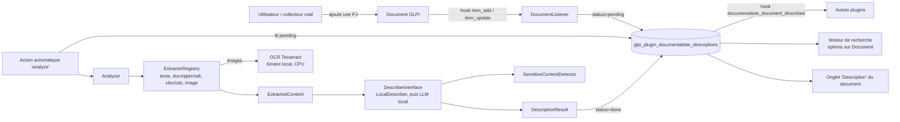

# Architecture

## Flux



## Composants (`plugins/documentaliste/src/`)

| Classe | Rôle |
|---|---|
| `Description` | `CommonDBTM`, une ligne par document. File d'attente, action automatique, onglet, options de recherche, **API publique**. |
| `DocumentListener` | Hooks `item_add`, `item_update` (seulement si `sha1sum` change), `item_purge` sur `Document`. |
| `Analyzer` | Pipeline : contrôles (taille, type), extraction, description. |
| `Extractor\*` | Extraction locale sans dépendance externe. Bornes contre les fichiers énormes et les zip bombs. |
| `Ocr\TesseractOcr` | OCR des images via le binaire `tesseract` (français et anglais, 1 thread, délai max 60 s, OCR ignoré au-delà de 40 Mpx). Détecté automatiquement : sans lui, seules les dimensions sont extraites. |
| `Describer\DescriberInterface` | Point d'extension pour les modèles d'IA. `LocalDescriber` = repli sans IA. |
| `SensitiveContentDetector` | Détection **synchrone et locale** : mots de passe, clés privées, jetons d'API, IBAN (mod 97), cartes (Luhn). Renvoie des catégories, jamais les valeurs. |
| `Install` | Schéma SQL et enregistrement de l'action automatique. |

## Table `glpi_plugin_documentaliste_descriptions`

| Colonne | Contenu |
|---|---|
| `documents_id` (unique) | Document GLPI |
| `sha1sum` | Empreinte du fichier. Un même contenu n'est analysé qu'une fois. |
| `status` | `pending`, `done`, `skipped` (type non géré ou fichier trop gros) ou `error` (après 3 tentatives) |
| `summary`, `keywords` (JSON) | Description et mots-clés |
| `detected_types` (JSON), `sensitivity` | Catégories sensibles. Niveaux : 0 = aucun, 1 = données personnelles, 2 = secret. |
| `describer`, `model` | Origine de la description : `local`, et le moteur OCR utilisé (ex. `tesseract 5.5.0 (fra+eng)`) |
| `attempts`, `error_message`, `date_analyzed` | Suivi des tentatives |

## Contrat pour les autres plugins

```php
use GlpiPlugin\Documentaliste\Description;
use GlpiPlugin\Documentaliste\SensitiveContentDetector;

// Lire la description d'un document
$description = Description::getForDocument($documents_id);
if ($description?->isDone()) {
    $description->fields['summary'];
    $description->getKeywords();
    $description->getDetectedTypes();
}

// Réagir à chaque nouvelle analyse
$PLUGIN_HOOKS[Description::HOOK_DESCRIBED]['monplugin'] = [
    Description::class => [MaClasse::class, 'onDescribed'], // reçoit l'objet Description
];

// Contrôle synchrone d'un texte (ex. dans un pre_item_add sur ITILFollowup)
$types = (new SensitiveContentDetector())->detect($texte);
```

## Confidentialité : aucune donnée ne sort du serveur

- Toute l'analyse s'exécute sur le serveur GLPI : PHP, `tesseract` en local, et plus tard un LLM installé sur ce même serveur.
- `tests/Unit/NoNetworkEgressTest.php` interdit dans le code du plugin les primitives réseau (`curl_*`, sockets, `mail`, flux `http://`…),
  les clients HTTP (Guzzle, Symfony HttpClient, `Toolbox::callCurl`…), et tout programme externe autre que `tesseract`.
- Seules des catégories de contenu sensible sont stockées, jamais les valeurs.

## Choix du moteur OCR

| Moteur | Matériel | Précision (captures d'écran, scans) | Installation | Retenu |
|---|---|---|---|---|
| **Tesseract 5** (LSTM) | CPU seul, environ 0,3 s par capture d'écran sur 1 cœur | Très bonne sur le texte d'écran et les documents | `apt install tesseract-ocr tesseract-ocr-fra` | ✅ |
| PaddleOCR / RapidOCR | CPU possible, plus lent ; meilleur sur les photos | Excellente | Pile Python ou ONNX à maintenir | Alternative future |
| docTR, EasyOCR | GPU recommandé | Excellente | PyTorch (plusieurs Go) | ❌ trop lourd |

`OcrEngineInterface` permet d'ajouter un autre moteur local sans toucher au reste.

## Pourquoi un fonctionnement asynchrone

Un appel à un modèle d'IA prend plusieurs secondes et peut échouer. Le faire pendant l'ajout du document
ralentirait l'envoi et le collecteur de mails. Le **blocage** (mot de passe dans un ticket) s'appuie donc
sur le `SensitiveContentDetector` local et synchrone. La description par IA arrive ensuite et peut déclencher
des alertes a posteriori.
